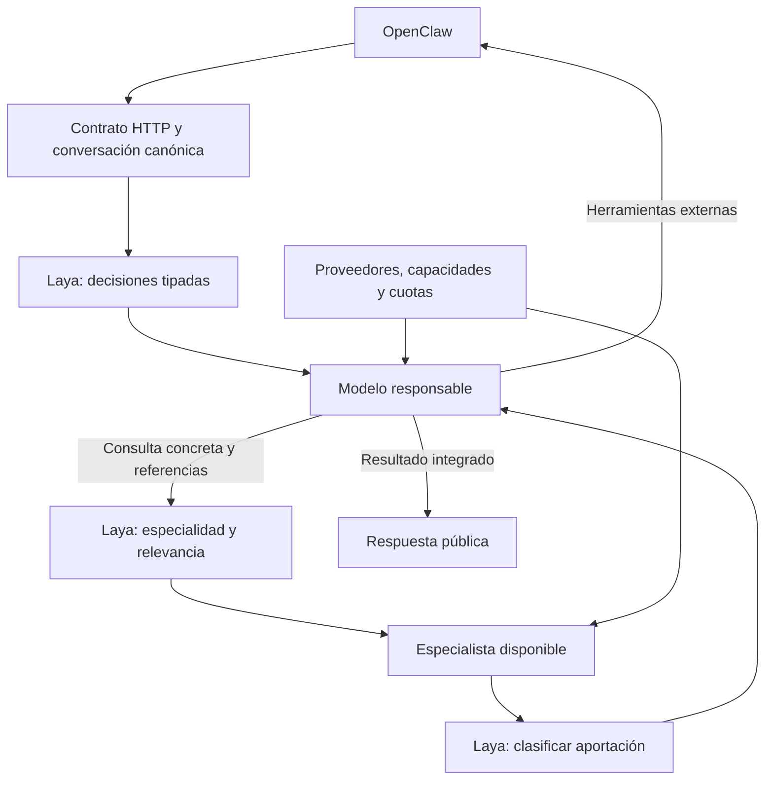

# OpenSwarm Gateway

Gateway multimodelo en TypeScript/Node.js 22 y Fastify. Expone `openswarm-auto` mediante Chat Completions para OpenClaw y otros clientes compatibles. Código del Gateway bajo [MIT](LICENSE).

Laya orienta intención, especialidad y transferencias. Un modelo responsable resuelve la tarea y puede consultar especialistas; sus aportaciones regresan al responsable. Los proveedores gratuitos Groq y OpenRouter pueden coexistir, con servidor local opcional.

## Desarrollo guiado por especificaciones

La arquitectura y los requisitos están versionados en [specs/roadmap.md](specs/roadmap.md). Leer [el flujo SDD](specs/README.md) y [la constitución](specs/constitution.md). Cada especificación tiene contrato, plan, tareas y evidencia. Las decisiones transversales están en `docs/adr`.

```sh
npm ci
npm run verify
```

`verify` comprueba referencias de requisitos, tipos, pruebas offline y compilación. Las pruebas reales son optativas y consumen cuota. Un criterio bloqueado no se marca aprobado.

## Arranque local

En una instalación nueva:

```sh
cp .env.example .env
cp config.example.yaml config.yaml
```

Configura `GROQ_API_KEY`, `OPENROUTER_API_KEY` y una `GATEWAY_API_KEY` propia. El cliente usa la clave del Gateway. No sobrescribas un `.env` existente.

```sh
npm run dev:laya
# Otra terminal:
npm run dev
```

Laya requiere primero:

```sh
uv venv --python 3.11 .venv-laya
uv pip install --python .venv-laya/bin/python -r requirements-laya.txt
```

El servicio local de Laya usa CPU y un checkpoint multilingüe con revisión `reviewed`. Necesita descargarlo la primera vez. Si no está disponible o se abstiene, se usa una decisión generativa dentro del presupuesto.

Para ejecutar la compilación:

```sh
npm run build
npm start
```

El Gateway escucha en `127.0.0.1:3000`. El YAML se carga al arrancar: reinicia después de modificarlo. Si aparece `EADDRINUSE`, identifica la instancia existente con `lsof -nP -iTCP:3000 -sTCP:LISTEN`; no inicies dos procesos en ese puerto.

```sh
curl http://127.0.0.1:3000/readyz
curl http://127.0.0.1:3000/v1/chat/completions \
  -H "Authorization: Bearer $GATEWAY_API_KEY" \
  -H 'Content-Type: application/json' \
  -d '{"model":"openswarm-auto","messages":[{"role":"user","content":"Hola"}],"stream":true}'
```

Para curl, exporta la clave en esa terminal. La aplicación carga `.env`; el shell no lo carga automáticamente.

## Arquitectura v2



### Decisión y contexto

- La intención se decide con IA, también para saludos. No hay atajos por palabras clave.
- Laya devuelve elecciones y probabilidades; no redacta contexto ni verifica código. El umbral 0.95 es provisional, no una garantía de precisión.
- Truncamiento, abstención, respuesta inválida o indisponibilidad recurren al modelo de decisión generativa.
- Los paquetes incluyen pregunta, fuentes pertinentes e instrucciones originales. Se conservan todas las instrucciones system/developer y mensajes de usuario; la selección reduce evidencia adicional, no elimina silenciosamente requisitos.
- El especialista puede leer otras fuentes con un control interno. Los fragmentos usados para enrutar se etiquetan como extractos; las fuentes completas siguen disponibles.
- Las consultas se ejecutan secuencialmente. Los resultados de modelos se etiquetan como no verificados. La evidencia de herramientas conserva su origen.

### Proveedores y gratuidad

`version: 2` añade `providers`, alias de modelos con `provider`/`remoteId`, capacidades, especialidades, `quotaGroups` y `collaboration`.

La prioridad inicial es Groq → OpenRouter → local, respetando especialidad y fallbacks explícitos. Los IDs del ejemplo se validan contra el catálogo; su disponibilidad puede cambiar. Los modelos de moderación/audio no entran en generación.

- **Groq:** `freeAccount: true` es una declaración del operador; el catálogo no verifica facturación. Usa una cuenta Free. No implica acceso ilimitado.
- **OpenRouter:** solo IDs explícitos `:free` con precios anunciados de cero; un candidato con precio desconocido se excluye.
- **Local:** proveedor deshabilitado por defecto. Para habilitarlo, declara URL, modelo, ventana de contexto y parámetros realmente soportados. Compatible con servidores Chat Completions como Ollama `/v1`; no usa endpoints nativos de Ollama.

Un proveedor sin credenciales o con catálogo fallido queda fuera de servicio sin impedir usar los demás. El catálogo se refresca cada cinco minutos. `GET /v1/status` autenticado muestra disponibilidad sin claves.

El Gateway filtra contexto/capacidades y reserva cuota por cuenta/modelo/grupo. Un límite compartido no se reinicia al cambiar de modelo. Los errores 429 y cabeceras de cuota actualizan el ledger SQLite. Se prueban alternativas antes de esperar; las esperas por cuota se acotan a cinco segundos. Otras aplicaciones pueden consumir la misma cuenta: el ledger no sustituye al proveedor.

No se habilita pago automáticamente. Agotar todas las cuotas produce un error explícito. Un contexto obligatorio mayor que la capacidad admitida produce `quota_request_too_large` o `context_length_exceeded`, sin descartar mensajes.

### Límites iniciales

| Control | Valor |
| --- | --- |
| Consultas a especialistas / profundidad | 3 / 2 |
| Intentos generativos, incluidos fallbacks | 8 |
| Decisiones Laya | 12 |
| Rondas externas de herramientas | 4 |
| Presupuesto por tarea | 60000 tokens |
| Paquete de fuentes adicionales | 6000 tokens estimados |
| Salida por llamada / decisión generativa | 2048 / 1024 tokens |
| Tiempo por intento / petición HTTP | 120 / 300 segundos |
| Caducidad por inactividad | 24 horas |

Los tokens se estiman con `o200k_base`, margen y sobrecarga de protocolo; no es el tokenizador exacto de todos los modelos. Las reservas se ajustan con uso real. Fallos sin uso medido conservan la reserva; HTTP 429 previo a generación libera tokens pero cuenta el intento. `run_budget_exceeded` es un error local HTTP 400 y se distingue de la cuota remota.

## Contrato HTTP y herramientas

| Endpoint | Función |
| --- | --- |
| `POST /v1/chat/completions` | Texto, JSON/SSE y herramientas de función |
| `GET /v1/models` | Modelo público `openswarm-auto` |
| `GET /v1/status` | Estado de proveedores |
| `GET /healthz` | Proceso activo |
| `GET /readyz` | SQLite y al menos un modelo de catálogo disponibles |

`/v1/*` requiere Bearer. Se admite una clave compartida, una instancia y SQLite; no hay aislamiento multiusuario. Readiness no prueba disponibilidad de inferencia ni cuota en cada cuenta.

Se mantienen messages de texto, n=1, tools/function, tool_choice, parallel_tool_calls, temperature, top_p, stop, max_tokens o max_completion_tokens y stream_options.include_usage. Las partes de contenido de tipo text se normalizan. Se rechazan explícitamente imágenes/audio, Responses API, response_format público y campos no implementados. La compatibilidad se limita a este contrato.

Las herramientas se validan con JSON Schema draft-07, referencias locales y sin coerción. OpenClaw las ejecuta y devuelve todos los resultados pendientes junto con la conversación y definiciones originales. Cambios de espacios/orden de claves en argumentos JSON se aceptan; cambios de valores no. Las continuaciones duplicadas completadas reproducen la respuesta sin inferencia nueva; las conflictivas devuelven 409. Los IDs nuevos son `call` + hexadecimal y siguen aceptándose alias históricos.

Los nombres `__openswarm_*` se reservan para controles internos y nunca se publican al cliente. `tool_choice: none` deshabilita las herramientas externas; las consultas internas siguen permitidas. Un tool_choice requerido o con nombre se aplica a las herramientas del cliente.

La colaboración mantiene borradores privados y entrega la respuesta integrada mediante SSE al terminar. Las respuestas directas pueden transmitir durante la generación. No se cambia de modelo tras publicar texto. Los errores posteriores a iniciar SSE se envían como evento de error y cierran sin `[DONE]`.

Tras una ronda externa completa se puede cambiar de proveedor usando resultados como evidencia portable, sin reemitir llamadas. El estado opaco del modelo original no cruza proveedores. La persistencia no garantiza ejecución única si el cliente vuelve a ejecutar una herramienta por su cuenta.

`usage` se informa solo cuando el uso está completo; no se sustituyen mediciones por estimaciones. `finish_reason: length` indica salida truncada; una aportación intermedia truncada no se integra como completa.

## OpenClaw

Conserva tu proveedor `openswarm` con:

| Campo | Valor |
| --- | --- |
| Base URL | `http://127.0.0.1:3000/v1` |
| API | `openai-completions` |
| Modelo | `openswarm-auto` |
| API key | Clave del Gateway |
| Timeout sugerido | 360 segundos |

El Gateway no modifica tu configuración personal. El contexto de OpenClaw puede superar las cuotas de entrada de Groq: Tool Search puede reducir el catálogo, pero no elimina las instrucciones de la sesión. OpenRouter gratuito o un modelo local configurado pueden admitir otro tamaño de contexto.

```sh
RUN_LIVE_SMOKE=1 npm run smoke:normal
RUN_LIVE_SMOKE=1 npm run smoke:openclaw
```

El primer comando usa el Gateway de OpenClaw ya iniciado, sin enviar a canales externos. El segundo usa una configuración aislada con read/write/exec y una carpeta de prueba. Sus resultados son evidencias diferentes. No inicies dos Gateways de OpenClaw sobre el mismo directorio de estado.

## Docker

Detén las instancias que ocupen 3000/8001 antes de arrancar Compose:

```sh
docker compose -f compose.yaml -f compose.laya.yaml up -d --build
docker compose -f compose.yaml -f compose.laya.yaml logs -f gateway laya
```

Compose conserva SQLite y checkpoints en volúmenes. La primera descarga puede tardar. Ejecuta una sola réplica por base. No uses `down -v` si quieres conservar datos.

## Migración y evaluación

El perfil Groq anterior puede migrarse con `node scripts/migrate-config.mjs`; guarda un respaldo y conserva límites. Los modelos personalizados requieren un mapeo explícito. SQLite se migra transaccionalmente a v2 y las ejecuciones previas usan el ejecutor histórico. No abras una DB v2 con el binario v0.1. Las ejecuciones interrumpidas no se repiten automáticamente.

```sh
npm run eval:routing -- --development
npm run eval:routing
RUN_LIVE_BENCHMARK=1 BENCHMARK_MAX_RUNS=3 npm run benchmark
```

Routing tiene 20 casos de desarrollo y 60 de evaluación separados. El benchmark compara modelo único, secuencia y colaboración sobre 20 funciones con assertions. El código generado se ejecuta únicamente en Docker, sin red, con filesystem de solo lectura y recursos acotados. Los resultados están en `data/`, excluidos de Git. Las pruebas unitarias no demuestran calidad generativa.

Consulta [la validación v0.2](docs/v0.2-validation.md). El informe `docs/laya-validation.md` corresponde al prototipo anterior y no valida v0.2.

Referencias: [Laya](https://nandhakishorm.github.io/laya/http-api/), [límites Groq](https://console.groq.com/docs/rate-limits), [límites OpenRouter](https://openrouter.ai/docs/api_reference/limits). Modelos y dependencias mantienen sus licencias propias.
